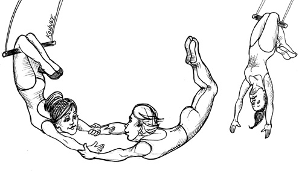

# Chap11. DIP: THE DEPENDENCY INVERSION PRINCIPLE DIP：依赖反转原则

The Dependency Inversion Principle (DIP) tells us that the most flexible systems are those in which source code dependencies refer only to abstractions, not to concretions.

> 依赖反转原则（DIP）主要想告诉我们的是，如果想要设计一个灵活的系统，在源代码层次的依赖关系中就应该多引用抽象类型，而用具体实现。

In a statically typed language, like Java, this means that the use, import, and include statements should refer only to source modules containing interfaces, abstract classes, or some other kind of abstract declaration. Nothing concrete should be depended on.

> 也就是说，在 Java 这类静态类型的编程语言中，在使用 use、import、include 这些语句时应该只引用那些包含接口、抽象类或者其他抽象类型声明的源文件，不应该引用任何具体实现。

The same rule applies for dynamically typed languages, like Ruby and Python. Source code dependencies should not refer to concrete modules. However, in these languages it is a bit harder to define what a concrete module is. In particular, it is any module in which the functions being called are implemented.

> 同样，在 Ruby、Python 这类动态类型语言中，我们也不应该在源代码层面引用包含具体实现的模块。当然，在这类语言中，确实很难清晰界定某个模块是否属于“具体实现”。

Clearly, treating this idea as a rule is unrealistic, because software systems must depend on many concrete facilities. For example, the String class in Java is concrete, and it would be unrealistic to try to force it to be abstract. The source code dependency on the concrete java.lang.string cannot, and should not, be avoided.

> 显而易见，把这条设计原则当成金科玉律来加以严格执行是不现实的，因为软件系统在实际构造中不可避免地需要依赖到一些具体实现。例如，Java 中的 String 类就是这样一个具体实现，我们将其强迫转化为抽象类是不现实的，而在源代码层次上也无法避免对 java.lang.String 的依赖，并且也不应该尝试去避免。

By comparison, the String class is very stable. Changes to that class are very rare and tightly controlled. Programmers and architects do not have to worry about frequent and capricious changes to String.

> 但 String 类本身是非常稳定的，因为这个类被修改的情况是非常罕见的，而且可修改的内容也受到严格的控制，所以程序员和软件架构师完全不必担心 String 类上会发生经常性的或意料之外的修改。

For these reasons, we tend to ignore the stable background of operating system and platform facilities when it comes to DIP. We tolerate those concrete dependencies because we know we can rely on them not to change.

> 同理，在应用 DIP 时，我们也不必考虑稳定的操作系统或者平台设施，因为这些系统接口很少会有变动。

It is the volatile concrete elements of our system that we want to avoid depending on. Those are the modules that we are actively developing, and that are undergoing frequent change.

> 我们主要应该关注的是软件系统内部那些会经常变动的（volatile）具体实现模块，这些模块是不停开发的，也就会经常出现变更。

## STABLE ABSTRACTIONS 稳定的抽象层

Every change to an abstract interface corresponds to a change to its concrete implementations. Conversely, changes to concrete implementations do not always, or even usually, require changes to the interfaces that they implement. Therefore interfaces are less volatile than implementations.

> 我们每次修改抽象接口的时候，一定也会去修改对应的具体实现。但反过来，当我们修改具体实现时，却很少需要去修改相应的抽象接口。所以我们可以认为接口比实现更稳定。

Indeed, good software designers and architects work hard to reduce the volatility of interfaces. They try to find ways to add functionality to implementations without making changes to the interfaces. This is Software Design 101.

> 的确，优秀的软件设计师和架构师会花费很大精力来设计接口，以减少未来对其进行改动。毕竟争取在不修改接口的情况下为软件增加新的功能是软件设计的基础常识。

The implication, then, is that stable software architectures are those that avoid depending on volatile concretions, and that favor the use of stable abstract interfaces. This implication boils down to a set of very specific coding practices:

> 也就是说，如果想要在软件架构设计上追求稳定，就必须多使用稳定的抽象接口，少依赖多变的具体实现。下面，我们将该设计原则归结为以下几条具体的编码守则：

- Don’t refer to volatile concrete classes. Refer to abstract interfaces instead. This rule applies in all languages, whether statically or dynamically typed. It also puts severe constraints on the creation of objects and generally enforces the use of Abstract Factories.
- Don’t derive from volatile concrete classes. This is a corollary to the previous rule, but it bears special mention. In statically typed languages, inheritance is the strongest, and most rigid, of all the source code relationships; consequently, it should be used with great care. In dynamically typed languages, inheritance is less of a problem, but it is still a dependency—and caution is always the wisest choice.
- Don’t override concrete functions. Concrete functions often require source code dependencies. When you override those functions, you do not eliminate those dependencies—indeed, you inherit them. To manage those dependencies, you should make the function abstract and create multiple implementations.
- Never mention the name of anything concrete and volatile. This is really just a restatement of the principle itself.

---

> - 应在代码中多使用抽象接口，尽量避免使用那些多变的具体实现类。这条守则适用于所有编程语言，无论静态类型语言还是动态类型语言。同时，对象的创建过程也应该受到严格限制，对此，我们通常会选择用抽象工厂（abstract factory）这个设计模式。
> - 不要在具体实现类上创建衍生类。上一条守则虽然也隐含了这层意思，但它还是值得被单独拿出来做一次详细声明。在静态类型的编程语言中，继承关系是所有一切源代码依赖关系中最强的、最难被修改的，所以我们对继承的使用应该格外小心。即使是在稍微便于修改的动态类型语言中，这条守则也应该被认真考虑。
> - 不要覆盖（override）包含具体实现的函数。调用这类函数通常就意味着引入源代码级依赖。即使覆盖它们，也无法消除这些依赖，因为函数会继承原有依赖关系。控制依赖关系的唯一办法，是创建一个抽象函数，再为它提供多种具体实现。
> - 应避免在代码中写入与任何具体实现相关的名字，或者是其他容易变动的事物的名字。这基本上是 DIP 原则的另外一个表达方式。

## FACTORIES 工厂模式

To comply with these rules, the creation of volatile concrete objects requires special handling. This caution is warranted because, in virtually all languages, the creation of an object requires a source code dependency on the concrete definition of that object.

> 如果想要遵守上述编码守则，我们就必须要对那些易变对象的创建过程做一些特殊处理，这样的谨慎是很有必要的，因为基本在所有的编程语言中，创建对象的操作都免不了需要在源代码层次上依赖对象的具体实现。

In most object-oriented languages, such as Java, we would use an Abstract Factory to manage this undesirable dependency.

> 在 Java 等大多数面向对象语言中，我们会使用抽象工厂来管理这种不理想的依赖关系。

The diagram in Figure 11.1 shows the structure. The Application uses the ConcreteImpl through the Service interface. However, the Application must somehow create instances of the ConcreteImpl. To achieve this without creating a source code dependency on the ConcreteImpl, the Application calls the makeSvc method of the ServiceFactory interface. This method is implemented by the ServiceFactoryImpl class, which derives from ServiceFactory. That implementation instantiates the ConcreteImpl and returns it as a Service.

> 图 11.1 展示了这种设计模式的结构。Application 通过 Service 接口使用 ConcreteImpl，但仍须设法创建 ConcreteImpl 实例。为避免在源代码层面依赖 ConcreteImpl，Application 改为调用 ServiceFactory 接口的 makeSvc 方法。该方法由 ServiceFactoryImpl 类实现；这个类继承自 ServiceFactory，负责创建 ConcreteImpl 实例并将其作为 Service 返回。

<Figures figure="11-1">Use of the Abstract Factory pattern to manage the dependency</Figures>

The curved line in Figure 11.1 is an architectural boundary. It separates the abstract from the concrete. All source code dependencies cross that curved line pointing in the same direction, toward the abstract side.

> 图 11.1 中间的那条曲线代表了软件架构中的抽象层与具体实现层的边界。在这里，所有跨越这条边界源代码级别的依赖关系都应该是单向的，即具体实现层依赖抽象层。

The curved line divides the system into two components: one abstract and the other concrete. The abstract component contains all the high-level business rules of the application. The concrete component contains all the implementation details that those business rules manipulate.

> 这条曲线将整个系统划分为两部分组件：抽象接口与其具体实现。抽象接口组件中包含了应用的所有高阶业务规则，而具体实现组件中则包括了所有这些业务规则所需要做的具体操作及其相关的细节信息。

Note that the flow of control crosses the curved line in the opposite direction of the source code dependencies. The source code dependencies are inverted against the flow of control—which is why we refer to this principle as Dependency Inversion.

> 请注意，这里的控制流跨越架构边界的方向与源代码依赖关系跨越该边界的方向正好相反，源代码依赖方向永远是控制流方向的反转——这就是 DIP 被称为依赖反转原则的原因。

## CONCRETE COMPONENTS 具体实现组件

The concrete component in Figure 11.1 contains a single dependency, so it violates the DIP. This is typical. DIP violations cannot be entirely removed, but they can be gathered into a small number of concrete components and kept separate from the rest of the system.

> 图 11.1 中的具体组件只有一条依赖关系，因此违反了 DIP。这种情况很常见。我们不可能完全消除系统中的 DIP 违规，但可以把它们集中到少数几个具体组件中，并与系统其他部分隔离。

Most systems will contain at least one such concrete component—often called main because it contains the main1 function. In the case illustrated in Figure 11.1, the main function would instantiate the ServiceFactoryImpl and place that instance in a global variable of type ServiceFactory. The Application would then access the factory through that global variable.

> 大多数系统至少包含一个这样的具体组件。由于其中包含 main 函数，它通常被称为 main。在图 11.1 的例子中，main 函数会创建 ServiceFactoryImpl 实例，并将它放入一个类型为 ServiceFactory 的全局变量。随后，Application 通过这个全局变量访问工厂。

## CONCLUSION 本章小结

As we move forward in this book and cover higher-level architectural principles, the DIP will show up again and again. It will be the most visible organizing principle in our architecture diagrams. The curved line in Figure 11.1 will become the architectural boundaries in later chapters. The way the dependencies cross that curved line in one direction, and toward more abstract entities, will become a new rule that we will call the Dependency Rule.

> 随着本书继续讨论更高层次的架构原则，DIP 会一再出现。它将成为本书架构图中最显眼的组织原则。后续章节中，图 11.1 的曲线会成为架构边界；依赖关系跨越这条曲线时，必须朝一个方向指向更抽象的实体。这将成为一条新的规则，我们称之为依赖规则。
